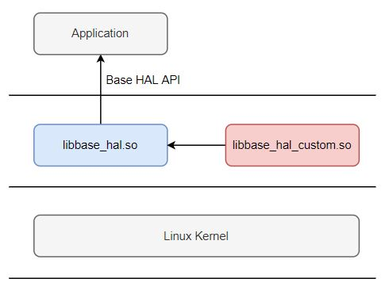

[toc]


# 概述

本文档为Base HAL开发指南，描述了Base HAL内部原理、以及HAL模块开发。

Base HAL框图如下：



其中，
- libbase_hal.so:
        通用实现，代码平台无关，对上层应用提供统一API。
- libbase_hal_custom.so:
        特定平台负责实现。在该库中实现的HAL接口将覆盖`libbase_hal.so`实现的HAL接口。
        建议把该库的代码和board代码放在一起，例如：board_ssc333/base_hal_custom。


# 文件层次结构

```
base_hal/
    |
    |-- doc/                        -- 文档，包括：用户手册/API文档/开发指南
    |
    |-- test/                       -- base_hal测试程序
    |
    |-- Config.in                   -- 负责包含各模块的 Config.in
    |-- local.mk                    -- 负责包含各模块的 local_sub.mk
    |-- include
    |      |--hal_xxx.h             -- 模块xxx的HAL接口声明
    |-- src
            |-- hal_dl
            |      |- local.mk
            |      |- hal_dl.c      -- 负责加载特定平台实现的 libbase_hal_custom.so
            |      |- hal_dl.h
            |      |- hal_dl_xxx.c  -- 从 libbase_hal_custom.so解析模块xxx的API
            |
            |-- xxx                 --  模块xxx
                |-- Config.in
                |-- local_sub.mk
                |-- hal_xxx_api.c   --  HAL接口实现
                |-- hal_xxx_core.c  --  HAL接口公共代码
                |-- hal_xxx_core.h
```

# 实现原理

## 接口调用过程

```shell
	if (特定平台 实现了 HAL接口)
		调用 特定平台的接口函数
	else
		调用 通用接口函数
```

## 接口实例

模块`xxx`的HAL接口用一个 `hal_if_xxx_t`结构体表示，实例名字为`hal_if_xxx`，二者均定义在`hal_xxx_core.h`文件中。如下：
```
/* HAL interface defination for xxx */
typedef struct {
    function pointers;
} hal_if_xxx_t;

/* HAL interface handle for xxx */
extern hal_if_xxx_t  hal_if_xxx;
```

## 动态插入平台特定接口

`base_hal/src/hal_dl`负责实现动态插入平台特定的hal接口。
```
        base_hal/
          |-- src
                 |-- hal_dl
                        |- local.mk
                        |- hal_dl.c
                        |- hal_dl.h
                        |- hal_dl_xxx.c        其中，xxx是模块名，比如watchdog
```

hal_dl加载`libbase_hal_custom.so`并获取特定平台实现的hal接口。
获取的接口将更新到对应模块的HAL接口实例`hal_if_xxx_t`。

特定平台负责实现`libbase_hal_custom.so`，并将其放在文件系统的`/lib`等标准搜索路径中。


# HAL模块开发

## 开发步骤

在base_hal中开发一个新的模块，通常包括以下步骤：
- 在 include 目录中，实现模块API头文件，例如：include/hal_led.h
- 在 src 目录中，实现模块API，例如：src/led/
- 在 src/hal_dl 目录中，实现特定平台接口动态插入功能，例如：src/hal_dl/hal_dl_led.c
- 在 test 目录中，实现模块API测试程序，例如： test/led/
- 在 doc/release/api/ 目录中，编写模块API文档，例如：hal_led_api.md

如果需要增加板级配置项：
- 修改 include/hal_board.h 增加配置项的定义
- 修改 配置文件模板 include/hal_board.json 增加配置项

# 平台适配

- 文档请参考 base_hal/doc/release/Tuya_Base_HAL_User_Manual.md
- 代码请参考 board_ssc333/base_hal_custom/
- 配置文件模板为 base_hal/include/hal_board.json
