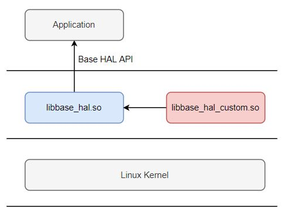

[toc]

# 概述

本文档为Base HAL用户手册，描述了Base HAL使用方法、以及特定平台的适配。

Base HAL框图如下：



其中，
- libbase_hal.so:
        通用实现，代码平台无关，对上层应用提供统一API。
- libbase_hal_custom.so:
        特定平台负责实现。在该库中实现的HAL接口将覆盖`libbase_hal.so`实现的HAL接口。


# 文件层次结构

Base HAL向用户提供HAL接口头文件和libbase_hal.so，目录结构如下：
```
    |-- include
    |     |-- hal_xxx.h      模块xxx的hal接口文件，例如 hal_led.h
    |
    |-- lib
          |-- libbase_hal.so
```


# 平台适配


## 板级配置

### 配置文件路径

板级配置文件采用json格式，默认路径为：`/etc/hal_board.json`

Base HAL在`include/hal_board.h`文件中，提供了 获取板级配置文件路径的回调函数`hal_board_get_config_file`。
如果需要修改为其它路径，特定平台可以在`libbase_hal_custom.so`中实现该函数，并返回自定义路径。

### 配置文件模板

配置文件模板为`include/hal_board.json`，摘录部分内容如下：
```
    {
        "board": "xxxxxx",

        "led_power_state": {
            "gpio_num": "-1",
            "high_active": "1"
        },
        "led_system_state": {
            "gpio_num": "-1",
            "high_active": "1"
        },

        "led_infrared": {
            "pwm_device": "0",
            "pwm_channel": "-1",
            "polarity_inversed": "0"
        },

        "key_factory_reset": {
            "gpio_num": "-1",
            "high_active": "1"
        },

        "pir": {
            "gpio_irq": "-1",
            "gpio_irq_high_active": "-1"
        },

        "ircut": {
            "ircut_pin1": "-1",
            "ircut_pin2": "-1"
        },

        "speaker": {
            "gpio_num": "-1",
            "high_active": "1"
        }
    }
```

### 配置项定义

配置项采用`键值对`形式。每个配置项包括3部分：
- 配置项名字： 在`include/hal_board.h`文件中，预定义了若干配置项。用户可以增加新的配置项。
- 配置项Key：  定义在`include/hal_board.h`。libbase_hal.so内部使用，用户不可修改。
- 配置项Value：统一采用字符串格式，在板级配置文件中填写具体取值。

配置项定义示例如下：

- 配置项名字定义示例：

```
/* Item definition */

// LED
#define ITEM_LED_RED            "led_red"
#define ITEM_LED_GREEN          "led_green"
```

- 配置项Key定义示例：

```
/* Key definition */

// LED
#define KEY_LED_GPIO_NUM            "gpio_num"
#define KEY_LED_HI_ACTIVE           "high_active"

```

### 如何增加一个配置项

新增一个配置项（假设是led_xxx），包括以下步骤：

- 修改`include/hal_board.h`，增加新配置项名字：
```
        #define LED_XXX           "led_xxx"
```
- 在板级配置文件中，增加配置项：
```
        "led_xxx": {
            "gpio_num": "100",
            "high_active": "1"
        }
```
- 调用hal_led_switch(LED_XXX, LED_ON或LED_OFF) 打开/关闭 led_xxx。


## 特定平台HAL接口实现

Base HAL支持动态插入特定平台实现的HAL接口。HAL接口调用过程如下：
```shell
	if (特定平台 实现了 HAL接口)
		调用 特定平台的接口函数
	else
		调用 通用接口函数
```

- 特定平台实现HAL接口的方式：

按照Base HAL头文件（例如include/hal_led.h）声明，在`libbase_hal_custom.so`中实现并导出对应的HAL接口。


## Base HAL底层接口

本节描述了Base HAL对下层的接口规范，即Base HAL API的通用实现对Linux驱动的需求。

在特定平台的实现中，如果Linux驱动不满足该接口规范，特定平台需要实现对应的HAL接口。

### GPIO

- 实现为Linux标准GPIO驱动
- 支持通过sysfs操作gpio，包括：
配置输入/输出方向；
读取/设置gpio电平；
检测gpio中断

### LED

对于开关型LED（亮度不可调节），满足以下两种情况之一：
- 实现LED驱动，并支持通过"/sys/class/leds/%s/brightness"打开/关闭LED。
- 不提供LED驱动，由Base HAL通过GPIO控制LED。LED管脚在板级配置文件中配置。

对于亮度可调节的LED，需满足：
- LED亮度通过PWM控制。

### 按键

- 实现为Linux标准按键驱动，创建设备节点(/dev/input/eventX)，上报标准键值或自定义键值。
  标准键值定义请参考 /usr/include/linux/input-event-codes.h。
  对应的Base HAL API： hal_input_event.h

- 对于单个GPIO控制的 非标准键值 按键（比如：恢复出厂设置按键），
  可以不实现按键驱动，由Base HAL通过GPIO获取按键状态。按键GPIO在板级配置文件中配置。
  对应的Base HAL API： hal_gpio_key.h

### IRCUT

- 不提供IRCUT驱动，通过2个GPIO控制IRCUT。GPIO在板级配置文件中配置。

2个GPIO的定义如下：

|IRCUT状态|ircut_pin1|ircut_pin2|备注|
|----|----|----|----|
|使能|High|Low|-|
|禁止|Low|High|-|
|休眠|Low|Low|若不支持休眠，要确保该电平状态不会引起IRCUT误动作|

### PIR

- 不提供PIR驱动，通过GPIO检测PIR中断。GPIO在板级配置文件中配置。
- 若需要软件配置PIR灵敏度，硬件需提供2个配置灵敏度的GPIO，定义如下：

|灵敏度级别|pir_set1|pir_set2|
|----|----|----|
|Low Level灵敏度|Low|Low|
|Middle Level灵敏度|Low|High|
|High Level灵敏度|High|Low|

备注：PIR灵敏度通常由硬件配置。

### Sensor

- Linux标准IIO驱动，支持通过sysfs读取sensor数据。

### IR

- Linux标准lirc驱动，具体要求如下：

|操作|驱动接口|备注|
|----|----|----|
|发送rawcode|对“发送设备节点”执行write操作|发送设备节点在板级配置文件设置<br>如果不设置，默认为 /dev/lirc1|
|接收rawcode|对“接收设备节点”执行read操作|接收设备节点在板级配置文件设置<br>如果不设置，默认为 /dev/lirc0|
|设置TX carrier frequency|通过 LIRC_SET_SEND_CARRIER 实现|-|

### PWM

- Linux标准pwm驱动，支持通过sysfs配置pwm

### ADC

- Linux标准IIO驱动，支持通过sysfs读取ADC数据

### 电机

- HAL通用实现只适用于Tuya电机驱动。

在特定平台中，如果使用其它电机驱动，特定平台需要实现电机HAL接口。

### SUB-G

- HAL通用实现只适用于Tuya sub-g驱动。
- 在sub-g驱动中，通过 .read 接收数据，通过 .write 发送数据。

在特定平台中，如果使用其它sub-g驱动，特定平台需要实现sub-g HAL接口。

### Audio

audio HAL接口目前没有通用平台实现，特定平台需要实现audio HAL接口。

### Video

video HAL接口目前没有通用平台实现，特定平台需要实现video HAL接口。
